<p align="center"></p>

# OpenTake

OpenTake is a free desktop app for recording yourself: it cleans up your microphone, makes your camera look better, records your screen and camera together with zoom on your clicks, and gives you a teleprompter that follows your voice. Everything runs on your computer.

Made by [Quetzal](https://quetzaltech.app). Free for everyone, open source under the MIT licence.

## What it does

**Microphone**
- A voice chain that runs live: noise suppression (RNNoise or Speex), gate, EQ with presence, de-esser, compressor, auto level and a limiter.
- Presets: Natural, Podcast, Broadcast and Noisy room, plus every stage adjustable by hand.
- Mic check: stay quiet, read a line out loud, and OpenTake tunes the chain to your room and your voice.
- Live meters for level, loudness (LUFS) and how much each stage is working.

**Camera**
- Looks: Natural, Warm, Cool, Cinematic, Bright, Black and white.
- Auto lighting that measures your face and adjusts exposure and colour, with a lighting score and histogram. Any slider you drag is yours until you hand it back.
- Background blur or replacement and auto framing, using on-device face detection and segmentation (MediaPipe).

**Record**
- Screen, window and camera recording, with the camera as a picture-in-picture.
- Any frame: 16:9, 9:16, 1:1, 4:5, 4:3 or a custom width and height, at 720p, 1080p, 1440p or 4K.
- Backgrounds: presets, your own colour, a two-colour gradient at any angle, or your own picture with optional blur.
- The screen window: size, position, padding, rounded corners, shadow, border, and a crop to cut off a taskbar or browser tabs.
- The camera: a circle or a rectangle with its own width, height and corner roundness, plus shadow and border. Drag it on the stage or snap it to a corner. A camera-only take can sit as a window over the background too.
- Looks: save the whole setup under a name and switch in one click, or go back to the standard look.
- Auto zoom: clicks are tracked globally and the export zooms in where you click.
- Scenes: switch live between camera, screen and camera, and screen while recording (buttons or Ctrl+Shift+1, 2, 3). The bubble grows into the full camera frame and back in one smooth move, and the take keeps a list of every switch.
- Pointer: click rings in your colour and size, and a spotlight that dims everything but the area around the pointer.
- Keystrokes: the shortcuts you press show as a pill near the bottom of the video. Only combos with Ctrl, Alt or Win (Cmd) show unless you turn on all keys; keys are drawn into the video and never saved anywhere else.
- Branding: a logo watermark in any corner, a name card (lower third) with your name and title in three styles, and intro and outro title cards recorded into the take. All of it is part of a saved look.
- A 3, 2, 1 countdown, pause, takes you can review, and separate screen and camera tracks if you want to edit elsewhere.
- MP4 export with optional silence trimming at the start and end and loudness normalisation.
- Draw on the screen while you record: pen, highlighter, arrow and rectangle in five colours, with undo and strokes that fade after 3 seconds (or stay). The drawing is in the recording, the toolbar is not.

**Edit and export**
- A take editor: play the take, see its waveform, set in and out points, split at the playhead and delete parts, with undo and redo and a zoomable timeline. Cuts save beside the take (edit.json) and are applied to every export, the hi-res one included.
- Captions made on your computer from the take's own sound (Vosk, English and Spanish), timed word by word and grouped into readable lines. Fix words, split, join and nudge lines; save .srt and .vtt, or burn them into the video in a Clean, Boxed or Social style, at the top or bottom. Captions follow your cuts.
- Export presets: Original, YouTube 1080p, Reels / TikTok / Shorts, Square, LinkedIn, X and a custom size, fitted with bars or filled and cropped. MP4, WebM or GIF, by quality or by a target file size (two passes).
- Editor keys: Space play, J K L back / pause / play, arrows step a frame (Shift a second), I and O set in and out, S split, Delete removes a part or restores a cut, Ctrl+Z undo, Ctrl+Shift+Z redo, Ctrl + wheel zoom.

**Use with Claude or Codex**
- OpenTake has an MCP server built in: ask Claude (Desktop or Code) or Codex to cut the pauses and ums, fix captions, find the best 60 seconds, add chapters or export a vertical cut with captions.
- It works on your take folders, on your computer, and changes only the edit and the captions: every change shows in the editor and can be undone from Settings.
- Settings, *Use with Claude or Codex*: one click sets up Claude Desktop, and there are commands to copy for Claude Code and Codex. See [docs/mcp.md](docs/mcp.md).

**Open in an editor**
- Write a take as an OpenTimelineIO (.otio) and FCPXML timeline with its cuts, and clicks, scene switches, chapters and captions as markers, for FilmCraft, DaVinci Resolve, Premiere or Final Cut. The captions come along as .srt.

**Takes, folders and names**
- A Takes tab lists every recording with its length, its exports and what it has (cuts, captions). Give a take a title, find it by title or date, and edit, export, show or delete it from there.
- Settings: record to any folder (Documents/OpenTake recordings by default), with its free space shown. Takes in a folder you used before stay listed there, so you can open it or switch back.
- Exports go next to the take, to one folder you choose, or wherever a Save dialog says each time. File names follow a template such as `{date} {time} {title} {preset}`, with a live example. A name that is taken gets a number, like (2): nothing is ever overwritten.
- After an export OpenTake can show it in its folder, open it, or do nothing.
- Folders with spaces, accents and other scripts work, and file names are made safe on every system.

**Help along the way**
- A short setup on the first launch: what you record, your mic and camera (with macOS permissions), and where takes go. Skip it any time; Settings opens it again.
- The Record panel is split into Setup, Look and Overlays. Setup starts with what a take needs (screen, mic, camera, folder), each missing piece with the one button that fixes it.
- A few suggestions when they help, each gone for good once dismissed: a background for an edge-to-edge screen, light for a dim camera, headphones when the computer's sound would echo, a roomier drive, the Reels preset for a vertical take, captions for a long one.
- Press ? (or Shortcuts in the left rail) for every keyboard shortcut.

**Safe with your takes**
- Closing OpenTake during a take asks first, then stops and saves it. During an export it asks before stopping it.
- A take the app closed on (a crash, a power cut) is finished on the next launch with its real length and marked Recovered.
- If the recordings drive is unplugged, OpenTake says so before recording and never quietly records somewhere else. If it goes away during a take, the take stops and keeps what was written.
- A failed export leaves no half-written file, and a full drive is named as the reason.
- Only one copy of OpenTake runs at a time; opening it again brings the window forward.

**Teleprompter**
- A floating, always-on-top prompter that sits under your webcam so your eyes stay near the lens.
- Voice tracking: speech recognition (Vosk, English and Spanish) runs on your computer and scrolls the script as you read.
- Speed, text size, line width, opacity, mirror mode for beam-splitter glass, click-through, and an option to hide it from screen recordings.

## Download

Get the latest version from [GitHub Releases](https://github.com/Svrubio7/Opentake/releases/latest):

- **Windows**: `OpenTake-<version>-win-x64.exe` (installer) or `OpenTake-<version>-portable.exe` (no install).
- **macOS**: `OpenTake-<version>-mac-arm64.dmg` for Apple Silicon, `OpenTake-<version>-mac-x64.dmg` for Intel.
- **Linux**: `OpenTake-<version>-linux-x86_64.AppImage`.

The builds are not code signed yet:

- **Windows** shows "Windows protected your PC". Click *More info*, then *Run anyway*.
- **macOS** says the app cannot be opened. Right-click OpenTake in Applications, choose *Open*, then *Open* again. Or run `xattr -dr com.apple.quarantine /Applications/OpenTake.app`.
- On macOS, zoom on clicks needs *Accessibility* permission and recording needs *Screen Recording* permission (System Settings, Privacy and Security). OpenTake asks the first time.

## Updates

OpenTake checks GitHub Releases for a new version shortly after it starts and every 6 hours.

- **Windows installer** and **Linux AppImage** download the update in the background and install it when you restart. The notice has a Restart button; it never restarts during a take or an export, and otherwise the update installs the next time you quit.
- **Windows portable** and **macOS** (until the mac builds are signed) tell you a new version is out and link to the download.
- The version and a *Check for updates* button are under About, at the bottom of the left rail.

## Privacy

Everything runs on your computer. There is no account, no sign-in, no telemetry and no analytics. Your voice, camera, screen and scripts never leave your machine: noise suppression, face detection, background segmentation and speech recognition all run locally, and the speech models ship inside the app. If you connect Claude or Codex, the assistant tools run on your computer too; what the assistant reads (a transcript, a frame) goes to it as part of your chat. OpenTake makes one kind of network request on its own: it asks GitHub whether a newer version has been released (after launch and every 6 hours) and downloads it if so. Nothing about you or your recordings is sent.

## Keyboard shortcuts

These work from any app while OpenTake is running (on macOS, Ctrl is Cmd). Press ? inside OpenTake to see them all.

| Shortcut | Action |
|---|---|
| Ctrl+Shift+R | Start or stop recording |
| Ctrl+Shift+P | Pause or resume recording |
| Ctrl+Shift+D | Draw on the screen: on or off |
| Ctrl+Shift+1 / 2 / 3 | Scene: camera / screen and camera / screen |
| Ctrl+Shift+L | Show or hide the name card |
| Ctrl+Alt+Space | Teleprompter: play or pause |
| Ctrl+Alt+Up / Down | Teleprompter: faster / slower |
| Ctrl+Alt+Right / Left | Teleprompter: next / previous sentence |
| Ctrl+Alt+Home | Teleprompter: back to the start |
| Ctrl+Alt+T | Teleprompter: click-through on or off |

While drawing: Esc stops, Ctrl+Z undoes, C clears, P, H, A and R pick the pen, highlighter, arrow and rectangle, and a right click rubs out one stroke.

The teleprompter shortcuts are active while the prompter is showing. Inside the teleprompter panel or window the same keys work without Ctrl+Alt: Space, arrows and Home.

## Build from source

You need Node.js 22 and npm.

```sh
git clone https://github.com/Svrubio7/Opentake.git
cd take
npm ci          # also downloads the ffmpeg binary for your platform
npm run dev     # run the app with hot reload
npm test        # unit tests
npm run typecheck
npm run dist    # build installers for your platform into release/<version>/
```

`npm run dist:win`, `dist:mac` and `dist:linux` build for one platform. `npm run dist:dir` builds an unpacked app without an installer, which is quicker for testing.

The speech models are stored with [Git LFS](https://git-lfs.com). Run `git lfs install` before cloning, or `git lfs pull` afterwards.

### Releasing

Push a tag like `v1.0.1` and the `release` workflow builds Windows, macOS (Apple Silicon and Intel) and Linux and attaches them to a draft GitHub release. Review the draft and publish it. Bump `version` in `package.json` first: the tag and the version must match.

### Code signing

Unsigned builds work but warn on first launch. To sign, add these secrets to the repository and the release workflow picks them up:

- Windows: `WIN_CSC_LINK` (base64 of the .pfx certificate) and `WIN_CSC_KEY_PASSWORD`.
- macOS: `CSC_LINK` (base64 of the Developer ID Application .p12) and `CSC_KEY_PASSWORD`, plus `APPLE_ID`, `APPLE_APP_SPECIFIC_PASSWORD` and `APPLE_TEAM_ID` for notarisation (then add `notarize: true` under `mac` in `electron-builder.yml`).
- Mac auto update needs a signed app and a `zip` target next to the `dmg` (Squirrel.Mac installs from the zip). Build signed macs with `MAIN_VITE_MAC_SIGNED=1` so the app installs updates instead of only announcing them.

### Where the repository name lives

The GitHub owner and repository (`Svrubio7/Opentake`) are set once in `package.json` under `repository`; electron-builder reads releases from there. If the repository moves, change that field and the links in this README and `CONTRIBUTING.md`.

## Licence

OpenTake is released under the [MIT licence](LICENSE). It ships with third-party software and models under their own licences, including FFmpeg (GPL-3.0, shipped as a separate unmodified program) and libuiohook (LGPL-3.0). See [THIRD_PARTY_NOTICES.md](THIRD_PARTY_NOTICES.md).

## Made by Quetzal

OpenTake is made by [Quetzal](https://quetzaltech.app), an AI social media manager for small businesses. More free tools at [quetzaltech.app/tools](https://quetzaltech.app/tools).
